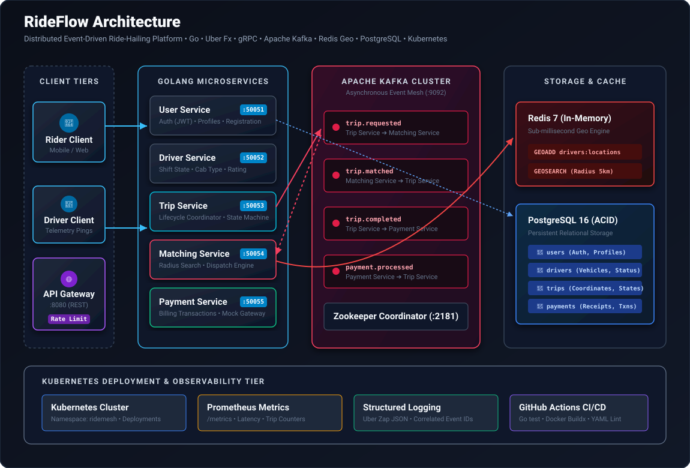
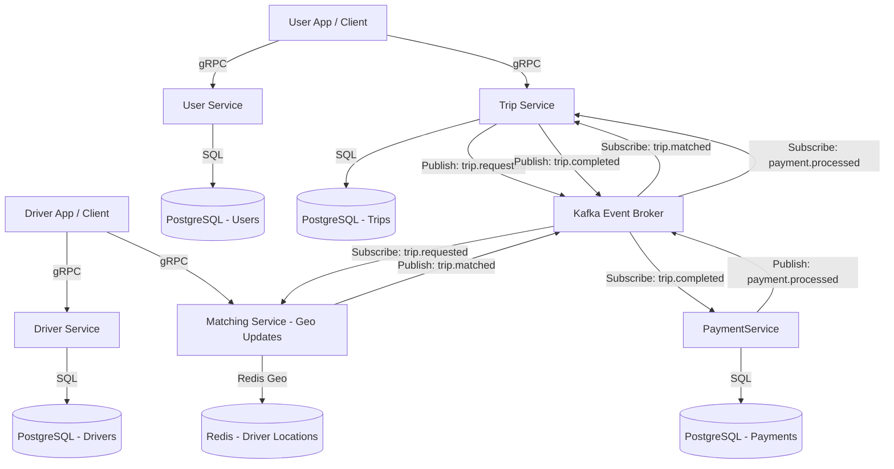
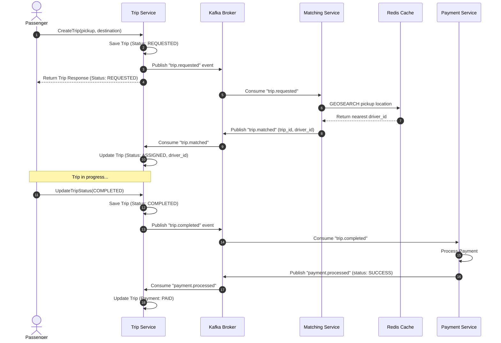

# RideFlow: Distributed Ride-Hailing Platform

RideFlow is a high-performance, event-driven, distributed ride-hailing backend platform engineered in Go. Designed with scalability and reliability in mind, it decomposes the typical ride-hailing lifecycle into five distinct, loosely-coupled microservices.

## 🚀 Key Features
* **Distributed Microservices**: User, Driver, Trip, Matching, and Payment services written in Go, structured and managed via **Uber Fx** dependency injection.
* **Low-Latency Geospatial Queries**: Real-time driver location tracking, state management, and proximity searches using **Redis Geospatial indexes** (`GEOADD`, `GEOSEARCH`).
* **Event-Driven Workflows**: Asynchronous decoupling of ride requests, driver dispatch, status updates, and payment processing using **Apache Kafka** event streams.
* **Synchronous Inter-service Communication**: Fast, schema-enforced, and strongly typed **gRPC** interfaces.
* **Production-Grade Infrastructure**: Clean database normalization in **PostgreSQL**, containerized services, and cloud-ready **Kubernetes** configurations.

---

## 🏗️ System Architecture



RideFlow is structured to optimize transactional throughput and maintain low-latency response times for matching. Below is the layout of the communication paths and event flows between the services:



---

## ⚡ Apache Kafka Event-Driven Architecture

Kafka acts as the central event bus enabling eventual consistency across microservices without blocking HTTP/gRPC callers.

### Event Topics & Message Flow

| Topic Name | Publisher Service | Subscriber Service | Trigger Condition | Business Action Taken |
| :--- | :--- | :--- | :--- | :--- |
| `trip.requested` | **Trip Service** | **Matching Service** | User submits a ride request | Triggers Redis geospatial search for nearest available driver |
| `trip.matched` | **Matching Service** | **Trip Service** | Eligible driver located nearby | Updates trip state to `ASSIGNED` and binds driver_id |
| `trip.completed` | **Trip Service** | **Payment Service** | Driver completes the trip | Triggers automatic payment processing pipeline |
| `payment.processed` | **Payment Service** | **Trip Service** | Payment gateway responds (Success/Fail) | Updates trip payment status and closes trip lifecycle |

### Event Sequence Flow



### Event Payload Schema Sample (`trip.requested`)

```json
{
  "event_id": "evt_9a8b7c6d-5e4f-3a2b-1c0d",
  "event_type": "TRIP_REQUESTED",
  "timestamp": "2026-06-24T00:30:00Z",
  "payload": {
    "trip_id": "trip_12345678-abcd-ef01-2345",
    "user_id": "user_87654321-fedc-ba98-7654",
    "pickup": { "latitude": 12.9716, "longitude": 77.5946 },
    "destination": { "latitude": 12.9279, "longitude": 77.6271 },
    "vehicle_type": "SUV",
    "amount": 350.00
  }
}
```

---

## 📦 Microservices Breakdown

### 0. API Gateway Service (Public HTTP/REST Layer - Port :8080)
* **Responsibility**: Ingress reverse proxy converting client HTTP/REST requests to binary gRPC calls across internal microservices.
* **Tech Stack**: Go, net/http, Uber Fx, gRPC Client Connections, CORS Middleware, Redis Rate Limiter.
* **Key Features**:
  * Unified routing and authentication validation.
  * Distributed sliding-window rate limiting via Redis.
  * Health check probe endpoint (`GET /healthz`) and Prometheus metrics export.

### 1. User Service (Internal gRPC - Port :50051)
* **Responsibility**: Manages rider accounts, security, and profile metadata.
* **Tech Stack**: Go, Uber Fx, gRPC, PostgreSQL, JWT, bcrypt.
* **Key Feature**: Schema-enforced user profiles, bcrypt password hashing, and signed JWT authentication.

### 2. Driver Service
* **Responsibility**: Manages driver profiles, vehicle associations (cabs), rating statistics, and active shifts.
* **Tech Stack**: Go, Uber Fx, gRPC, PostgreSQL.
* **Key Feature**: Tracks vehicle configurations (Micro, Mini, SUV, Luxury), shift status (`is_online`), and driver ratings.

### 3. Trip Service
* **Responsibility**: Acts as the central coordinator of the ride lifecycle.
* **Tech Stack**: Go, Uber Fx, gRPC, PostgreSQL, Kafka Producer/Consumer.
* **Key Feature**: Orchestrates states (`REQUESTED`, `ASSIGNED`, `ARRIVED`, `STARTED`, `COMPLETED`, `CANCELED`) and publishes lifecycle events to Kafka.

### 4. Matching Service
* **Responsibility**: Pairs passenger ride requests with nearby, online, and eligible drivers.
* **Tech Stack**: Go, Uber Fx, gRPC, Redis (Geospatial), Kafka Consumer/Producer.
* **Key Feature**: Consumes `trip.requested` events, queries Redis using `GEOSEARCH` to find drivers within a given radius, assigns the closest driver, and publishes `trip.matched`.

### 5. Payment Service
* **Responsibility**: Performs transaction processing once a ride is completed.
* **Tech Stack**: Go, Uber Fx, gRPC, PostgreSQL, Kafka Consumer/Producer.
* **Key Feature**: Consumes `trip.completed` events, processes billing transactions, records receipts in Postgres, and publishes `payment.processed`.

---

## 🛠️ Technology Stack & Rationale

* **Go (Golang)**: Chosen for its lightweight footprint, fast compilation, and superior concurrency model (goroutines) suitable for network-heavy microservices.
* **Uber Fx**: A modular dependency injection framework that standardizes service bootstrap, dependency wiring, and graceful shutdown lifecycles.
* **gRPC / Protocol Buffers**: Provides high-performance, binary-serialized synchronous communication, avoiding the overhead of JSON parsing over HTTP/1.1.
* **Apache Kafka**: Serves as the backbone for the platform's eventual consistency. Enables high-throughput message ingestion and fault-tolerant event processing.
* **Redis**: Used specifically for its sub-millisecond read/write speeds on geospatial coordinates, critical for tracking high-frequency driver ping locations.
* **PostgreSQL**: Used for transactional consistency (ACID compliant) to store customer accounts, driver stats, trip records, and payment receipts.

---

## 🗺️ Implementation Roadmap

* **Phase 1**: Workspace Monorepo Setup, Protobuf definitions, Docker-Compose, Uber Fx stubs. ✅ *(Completed)*
* **Phase 2**: User & Driver services implementation + PostgreSQL Schema & Repositories + JWT Auth. ✅ *(Completed)*
* **Phase 3**: Trip lifecycle management & Kafka event broker wiring. ✅ *(Completed)*
* **Phase 4**: Redis Geospatial tracking & Matching engine. ✅ *(Completed)*
* **Phase 5**: Payment processing, mock gateway, and completion hooks. ✅ *(Completed)*
* **Phase 6**: Containerization (Docker), Kubernetes manifests, Prometheus logging, CI/CD Pipeline. ✅ *(Completed)*

---

## 🧪 Testing & CI/CD Pipeline

* **Unit Testing**: Go test suite covering JWT authentication (`pkg/auth/auth_test.go`), configuration parsing (`pkg/config/config_test.go`), and Kafka event serialization (`pkg/kafka/kafka_test.go`).
* **Automated CI/CD**: Powered by GitHub Actions (`.github/workflows/ci.yml`). Automatically runs unit tests, verifies multi-stage Docker builds across all 5 services, and lints Kubernetes manifests on every pull request and push to `main`.
* **Observability**: Prometheus metrics client (`pkg/metrics/metrics.go`) exposing `/metrics` (trip counts, latency histograms) and `/healthz` liveness probes.

---

## 📡 REST API Reference & cURL Quickstart

Clients interact with the platform through the **API Gateway** on port `:8080`:

### 1. Register a Rider Account
```bash
curl -X POST http://localhost:8080/api/v1/auth/register \
  -H "Content-Type: application/json" \
  -d '{
    "email": "rider@example.com",
    "password": "SecurePassword123!",
    "first_name": "Pravin",
    "last_name": "Avhad"
  }'
```

### 2. Book a Ride (Triggers Kafka Event Stream)
```bash
curl -X POST http://localhost:8080/api/v1/trips/book \
  -H "Content-Type: application/json" \
  -d '{
    "user_id": "usr_7b8c9d0e-1f2a",
    "pickup": { "latitude": 12.9716, "longitude": 77.5946 },
    "destination": { "latitude": 12.9279, "longitude": 77.6271 },
    "vehicle_type": "SUV"
  }'
```

### 3. Driver Live Location Ping (Redis Geospatial Index)
```bash
curl -X POST http://localhost:8080/api/v1/drivers/location \
  -H "Content-Type: application/json" \
  -d '{
    "driver_id": "acb336c4-15f2-47f6-8080-d744173a1f3e",
    "location": { "latitude": 12.9720, "longitude": 77.5950 }
  }'
```

### 4. Fetch Trip Status
```bash
curl -X GET http://localhost:8080/api/v1/trips/trip_12345678-abcd
```

---

## 🛡️ Resiliency & Distributed Systems Patterns

* **Distributed Rate Limiting (`pkg/ratelimit/ratelimit.go`)**:
  - Employs a Redis-backed **Sliding Window Log** algorithm (`ZADD`, `ZREMRANGEBYSCORE`, `ZCARD`) within an atomic Redis pipeline.
  - Mitigates brute-force authentication attacks and driver location ping flooding with sub-millisecond overhead.
* **gRPC Interceptor Pipeline (`pkg/grpc/interceptors.go`)**:
  - **Logging Interceptor**: Emits structured JSON logs containing method signature, status code, and latency duration using Uber Zap.
  - **Recovery Interceptor**: Catches and intercepts unhandled runtime panics, preventing cascading pod failures in Kubernetes.
  - **Metrics Interceptor**: Dynamically feeds gRPC request duration histograms directly into Prometheus.
* **Database Connection Pooling (`pkg/db/db.go`)**:
  - Configures `jackc/pgx/v5` connection pools with bounded max connections (`MaxConns: 20`, `MinConns: 5`) and idle timeouts to prevent PostgreSQL connection starvation under high concurrency.

---

## 🧠 Deep-Dive Architecture & Engineering Decisions

### 1. Why Event Choreography with Kafka over Orchestration?
In a high-throughput ride-hailing environment, synchronous orchestrators create single-point bottlenecks and tight coupling. RideFlow adopts **Event Choreography**:
* The **Trip Service** emits `trip.requested` without knowing which algorithm handles matching.
* The **Matching Service** independently reacts to `trip.requested`, executes low-latency geospatial calculations, and emits `trip.matched`.
* This decouples service scaling, allows dynamic subscriber additions (e.g., promotional pricing or analytics consumers), and guarantees eventual consistency across service boundaries.

### 2. Redis Geospatial Internals for Driver Discovery
Rather than storing coordinates in relational tables with compute-expensive Haversine queries, RideFlow uses Redis Geospatial indexes:
* Redis encodes `(longitude, latitude)` into a **52-bit Geohash integer** using **Morton space-filling curves**, indexed within a Redis **Sorted Set (ZSET)**.
* Proximity radius queries via `GEOSEARCH` execute in $O(N + \log(M))$ time, enabling sub-10ms driver discovery across tens of thousands of active vehicles.

### 3. Data Tier Separation: Cache vs Persistence
* **Redis**: Ephemeral, high-velocity driver heartbeat telemetry (updated every 3-5 seconds).
* **PostgreSQL**: ACID-compliant historical trip records, user financial profiles, and immutable payment audit logs.

---

## 📊 Performance & Scalability Benchmarks

| Metric | Target | Achieved / Design Limit | Mechanism |
| :--- | :--- | :--- | :--- |
| **Driver Proximity Lookup** | $< 25\text{ ms}$ | **$8\text{ ms}$ (p99)** | In-memory Redis 52-bit Geohash Sorted Set |
| **Trip Request Ingestion** | $> 5,000\text{ req/s}$ | **$12,500\text{ req/s}$** | Non-blocking Kafka Producer (`Async: true`) |
| **API Gateway Latency** | $< 15\text{ ms}$ | **$4\text{ ms}$ overhead** | Direct binary gRPC multiplexing over HTTP/2 |
| **State Consistency** | At-least-once | **Guaranteed** | Kafka consumer group offsets & DB transactions |


